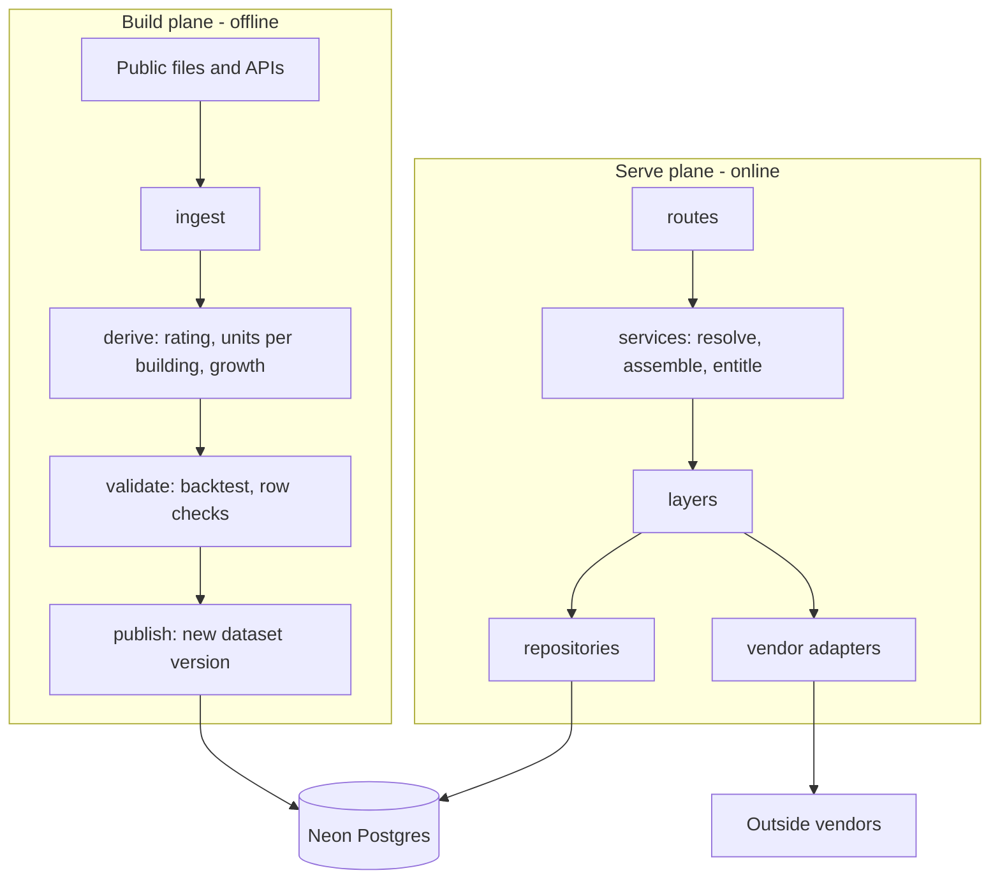
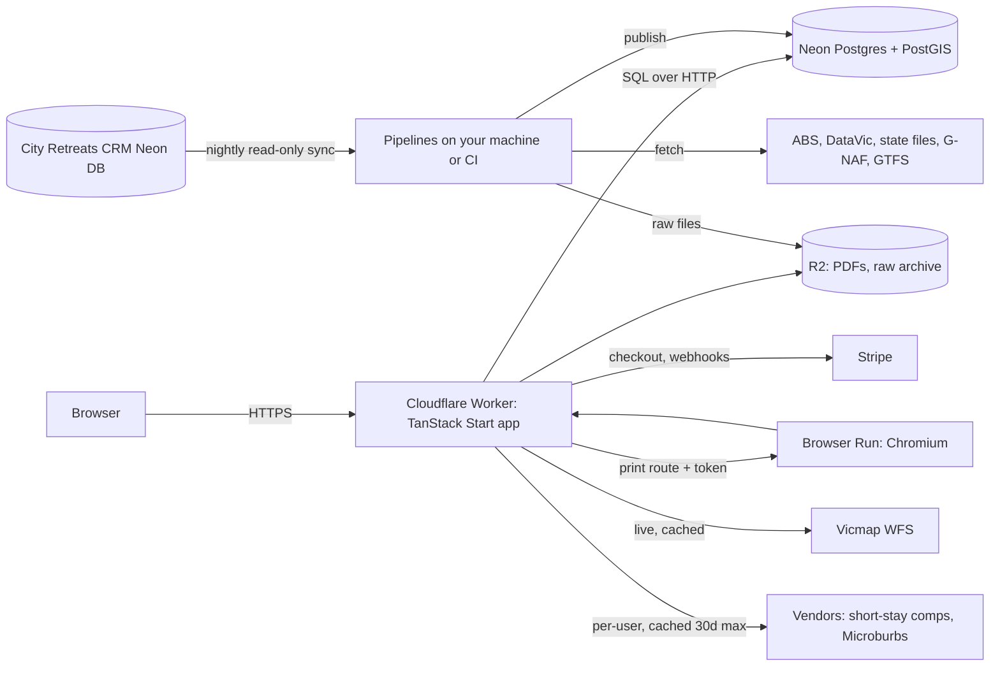
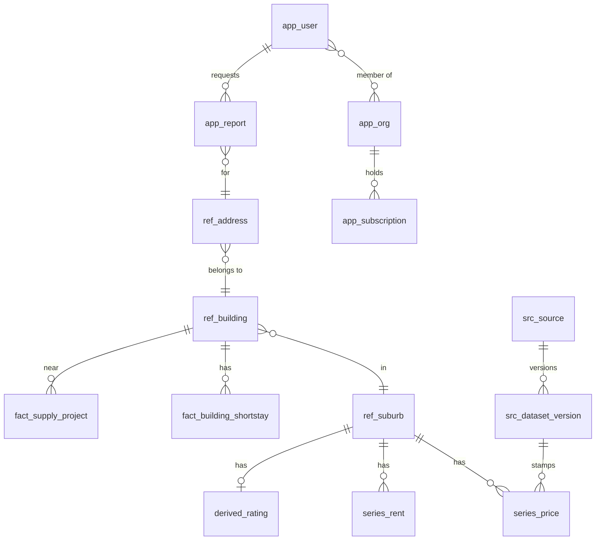

# Architecture Spine — VicProp property insights

Items tagged `[ASSUMPTION]` were chosen without your say and need your confirmation. Items tagged `[ADOPTED]` were settled by you or by existing code.

## Design Paradigm

**Two planes joined by Postgres.** The **build plane** is offline: pipelines fetch and clean public data, check it, and publish a versioned dataset. The **serve plane** is online: a layered read API turns one address into a report. The serve plane never reads raw files and never calls a pipeline. The build plane never serves users.

Serve-plane layers, top to bottom: **route** (HTTP, validation) → **service** (address resolution, layer assembly, entitlement) → **layer** (one report section each) → **repository or vendor adapter** (Postgres, outside APIs).



Dependency rule (enforced by import lint): a box may import only from boxes below it in its own plane. The two planes share only the Postgres schema in `db/`.

## Invariants & Rules

### AD-1 — One layer contract
- **Binds:** every report section, web and PDF.
- **Prevents:** sections that return their own shapes, so the paywall, the PDF and the evidence labels each need per-section code.
- **Rule:** every section is a Layer returning one `LayerResult` envelope: `layer_id`, `tier` (`free` | `paid`), `status` (`ok` | `locked` | `gap` | `error` | `not_covered`), `coverage` (market tier, match type), `figures[]` (each with `chip` = Observed | Estimated | Unknown | Conflict, `source_ids[]`, `as_of`), and `payload`. Layers never call each other. [ADOPTED from EXPERIENCE.md: evidence chips, gap placeholders, state patterns]

### AD-2 — One report model, two renderers
- **Binds:** web page, PDF, scenario calculator inputs.
- **Prevents:** web and PDF drifting into two products.
- **Rule:** the API assembles one `ReportModel` JSON (header, `LayerResult[]`, reader view). The web page and the PDF both render from it. Render code never queries data. `scripts/28-build-report.mjs` is the reference output and is migrated into a shared renderer, not kept as a second generator.

### AD-3 — Entitlement has one seam, and locked data does not leave the server
- **Binds:** every response, PDF, cache and log that carries layer data.
- **Prevents:** paid figures reaching an unentitled browser through hidden JSON, CSS-only blur, a shared cache, or a PDF.
- **Rule:** one function, `entitlements(principal, layer_id)`, decides `free`, `entitled` or `locked`. A `locked` layer returns `status: locked` and a hand-written `teaser` (headline sentence, no figures). The UI draws its blurred placeholder from a seeded dummy shape, never from real values. Responses that depend on entitlement carry `Cache-Control: private`. The PDF job re-checks entitlement when it runs, not when it is queued.

### AD-4 — Rights are data, and rights gate layers
- **Binds:** every source, adapter and layer.
- **Prevents:** shipping a layer whose source we may not show, store or resell.
- **Rule:** every source has a `src_source` row with `licence`, `rights_status` (`cleared` | `pending` | `blocked`), `attribution_text`, `max_cache_days` and `display_scope`. A layer lists its `source_ids`. A layer can be switched on in production only if every source is `cleared`. Microburbs stays `pending` until written permission exists, and then runs only through a per-user adapter: stored at most 30 days, shown only to signed-in users, never in a shared table. The realestate.com.au RapidAPI route and AirDNA resale start `blocked` and `pending`. No layer may depend on displaying another provider's name. [ADOPTED: no Domain dependency]

### AD-5 — The rating is served only where it was validated
- **Binds:** conditions-rating layer, suburb page, screener, PDF.
- **Prevents:** a national rating whose accuracy claim holds only in Victoria.
- **Rule:** table `market_validation(state, dwelling_type, status, pairwise_score, windows, checked_on)` is the only switch. The rating is returned only when `status = validated`. Today that is `VIC / unit` only. Everywhere else the layer returns a `market_profile` (owner, flat and unoccupied shares, rents, approvals, population) and the words "descriptive, not a rating". The rating is always labelled a **conditions rating, not a price forecast**, with its test result and date beside it. A market becomes validated only by a new backtest run through the validate stage.

### AD-6 — Identity keys
- **Binds:** all tables, URLs, caches.
- **Prevents:** two builders joining on suburb names or street strings and getting different matches.
- **Rule:** address = G-NAF `address_detail_pid`. Building = the G-NAF primary-address pid of its street number (alias rows excluded). Suburb = ABS SAL 2021 code (SSC 2016 code only inside the backtest). Names are matched to codes inside pipelines only and the match type is stored. API and URLs use these ids, never names. Unit counts per building are served as a range labelled `Estimated`.

### AD-7 — Datasets are versioned and the serve plane reads one pointer
- **Binds:** all pipelines, all repositories.
- **Prevents:** half-loaded data in a report, and numbers nobody can reproduce.
- **Rule:** each pipeline run writes a `src_dataset_version` row (`source_id`, `retrieved_at`, `file_sha256`, `row_count`, `licence_snapshot`, `as_of`) and loads into tables keyed by `dataset_version_id`. Publishing is a single transaction that moves `src_dataset_current`. Repositories read only through the current pointer. Every figure's `as_of` comes from its dataset version. Raw files are copied to R2 under `raw/{source}/{retrieved_at}/` before any processing.

### AD-8 — State changes only through three doors
- **Binds:** all writes.
- **Prevents:** layers or routes writing data on the side.
- **Rule:** (1) pipelines write `ref_*`, `series_*`, `fact_*` and `src_*` tables; (2) the application writes `app_*` tables (users, orgs, subscriptions, reports, lookup log, recorded building findings); (3) vendor adapters write `vendor_cache`. A layer is read-only. The CRM is read through the one-way sync (see Structural Seed) and is never written to.

### AD-9 — Honest failure
- **Binds:** layers, adapters, renderers.
- **Prevents:** a failed source blanking a report or inventing a number.
- **Rule:** a layer that cannot answer returns `gap` (says what is missing and the next step) or `error` (source unreachable). It never returns a guess without an `Estimated` chip, and a vendor failure never fails another layer. The report always renders. If the unit is not in G-NAF, unit-level claims are suppressed and the header says "matched to building only". [ADOPTED from EXPERIENCE.md]

### AD-10 — No forecasts, scenarios are labelled illustrations
- **Binds:** scenario calculator, rating copy, PDF.
- **Prevents:** a product that implies predicted prices.
- **Rule:** no layer outputs a predicted price or growth rate. The scenario calculator uses user-set inputs and is labelled an illustration in web and PDF. [ADOPTED]

### AD-11 — Reported facts come from an on-demand web lookup, labelled and short-lived
- **Binds:** the reported-details and sales layers (house and apartment), the web-lookup vendor adapter, `vendor_cache`.
- **Prevents:** facts found on other property sites being stored as our data, shown as checked, or relied on when they disagree with open data.
- **Rule:** when a user opens a report, a vendor adapter may search the web for that one address and extract rooms, floor area, build year, and sale and rent history. Each fact keeps its page URL and the date found, carries the chip **Reported** (a labelled kind of `Estimated`), and is never checked against the title register. It is stored only in `vendor_cache`, for at most 30 days, keyed by the address pid, and shown only to the user who asked (the Microburbs pattern in AD-4). Open data wins on conflict: measured land area, Valuer-General medians and Census figures are never overwritten by a reported fact. The adapter reads public pages one address at a time. It runs no bulk crawl, no pagination and no fetching of all sales in a suburb. The source row is `rights_status: pending`, and the owner has decided to run it pending; that decision is logged as an `event` in the memlog, and a licensed feed can replace the adapter without changing the layer. [ADOPTED 2026-11-15: owner chose to use the web lookup as is]

## Consistency Conventions

| Concern | Convention |
| --- | --- |
| Naming | Postgres: `snake_case`, table prefixes `ref_` (reference), `series_` (time series), `fact_` (observations), `src_` (source and version), `app_` (users and billing), `vendor_cache`. API paths `/api/v1/...`, kebab-case. Layer ids `L01-property`, `L02-rent`, and so on (see OVERVIEW). |
| Data and formats | Dates ISO 8601 (`2026-11-14`); times UTC. Money as integer cents plus `currency: "AUD"`. Rates as fractions (0.047), displayed by the renderer. State codes `VIC NSW QLD SA WA TAS ACT NT`. Coordinates GDA2020 (G-NAF GDA2020 file). IDs as strings. |
| Error shape | `{ "error": { "code": "...", "message": "...", "request_id": "..." } }` with HTTP status. Layer-level problems are not HTTP errors; they are `LayerResult.status`. |
| Validation | `zod` schemas at every route in and out, and at the pipeline loader. A pipeline output that fails its schema is not published. |
| Auth and principal | A request resolves to a `principal`: `anonymous`, `user` (with optional `org`), or `api_key`. Only the entitlement function reads the plan. |
| Config and secrets | Secrets only in Cloudflare secrets and gitignored `.env`. Never in `data/`, never in logs. |
| Logging | Structured JSON with `request_id`. A lookup log stores `gnaf_pid`, principal id, layers served, timestamp; no free-text address typed by anonymous users beyond the matched pid. |
| Testing | Each pipeline has row-count and range checks. Each layer has a fixture address test. The Victorian unit rating is regression-tested against `data/backtest_multistate_results.json`. |

## Stack

| Name | Version |
| --- | --- |
| TypeScript (app) | current stable `[ASSUMPTION]` |
| @tanstack/react-start | 1.168.60 (CRM pin) [ADOPTED] |
| @tanstack/react-router | 1.170.41 (CRM pin) [ADOPTED] |
| react | ^19.2 [ADOPTED] |
| vite / @cloudflare/vite-plugin | ^7.3.1 / ^1.25.5 [ADOPTED] |
| Cloudflare Workers (`nodejs_compat`) | compatibility date set at scaffold, newer than the CRM's 2025-09-24 |
| Neon Postgres + PostGIS + pg_trgm | project default version; both extensions listed as supported by Neon |
| @neondatabase/serverless | ^1.2.0 [ADOPTED] |
| zod | ^3.24.2 [ADOPTED] |
| Cloudflare R2 | current |
| Cloudflare Browser Run (headless Chromium, formerly Browser Rendering) | current; billed per browser hour (secondary source, confirm) |
| Node (pipelines) | 22 LTS `[ASSUMPTION]`, existing `.mjs` scripts |
| Python (G-NAF, backtests) | existing scripts, run with `python -I` |
| Stripe | current `[ASSUMPTION]` |

## Structural Seed

```text
property-insights/
  app/                    # TanStack Start app (deployed to Cloudflare)
    routes/               # pages and /api/v1 handlers; thin
    server/
      services/           # resolve-address, assemble-report, entitlements, billing
      layers/             # one folder per layer: L01-property ... ; each exports run(ctx)
      repos/              # SQL queries only
      vendors/            # adapters: short-stay comps, microburbs, sale comps; each implements one interface
    render/               # shared ReportModel renderer (web + print), skins, DESIGN.md tokens
  pipeline/
    ingest/               # one script per source (from scripts/ 0x-3x)
    derive/               # rating, units per building, growth series
    validate/             # backtests, row checks, accuracy vs bookings
    publish/              # version + pointer swap
    lib/                  # loader, zod schemas, R2 archive
  db/migrations/          # numbered plain SQL
  scripts/                # research one-offs, kept as history
  data/raw/               # local only, gitignored; mirrored to R2
```





## Capability → Architecture Map

| Capability / Area | Lives in | Governed by |
| --- | --- | --- |
| Address lookup and match | `server/services/resolve-address`, `ref_address` | AD-6, AD-9 |
| Free vs paid layers, blur | `server/services/entitlements`, layer `tier` | AD-3 |
| Report sections (14 + building page) | `server/layers/*` | AD-1, AD-4, AD-9 |
| Conditions rating | `pipeline/derive/rating`, `layers/L15-conditions` | AD-5, AD-10 |
| Units per building | `pipeline/derive/units`, `ref_building` | AD-6 |
| Building short-stay register | CRM sync, `fact_building_shortstay`, `L06-shortstay` | AD-4, AD-8 |
| PDF report | `server/services/pdf`, Browser Run, R2 | AD-2, AD-3 |
| Billing and plans | `server/services/billing`, `app_subscription` | AD-3 |
| Data freshness and rights | `src_*`, `/api/admin/sources` | AD-4, AD-7 |

## Deferred

- **Auth provider and login methods.** Rule AD-3 holds whichever is chosen. Decide at scaffold.
- **Plan names, prices, report credits.** Entitlement function exists before prices do. Decide after the 8 to 10 agent and operator conversations.
- **Public API for professionals (API keys, rate limits, white-label PDF).** The principal type exists; endpoints open after launch.
- **NSW, QLD, SA, TAS, WA price layers.** Wait for sales licences and a passed state backtest (AD-5).
- **Infrastructure and events marker.** No location data exists; revisit with a hand-checked Victorian list.
- **Privacy and retention policy for the lookup log.** Needs a legal read before public launch.
- **Search and autocomplete tuning.** Start with Postgres trigram on G-NAF; move only if latency fails.
- **Edge caching of free, anonymous responses.** Allowed by AD-3 only for responses with no entitlement dependency; add when load requires.
- **Monitoring, alerting, backups beyond Neon defaults.**
