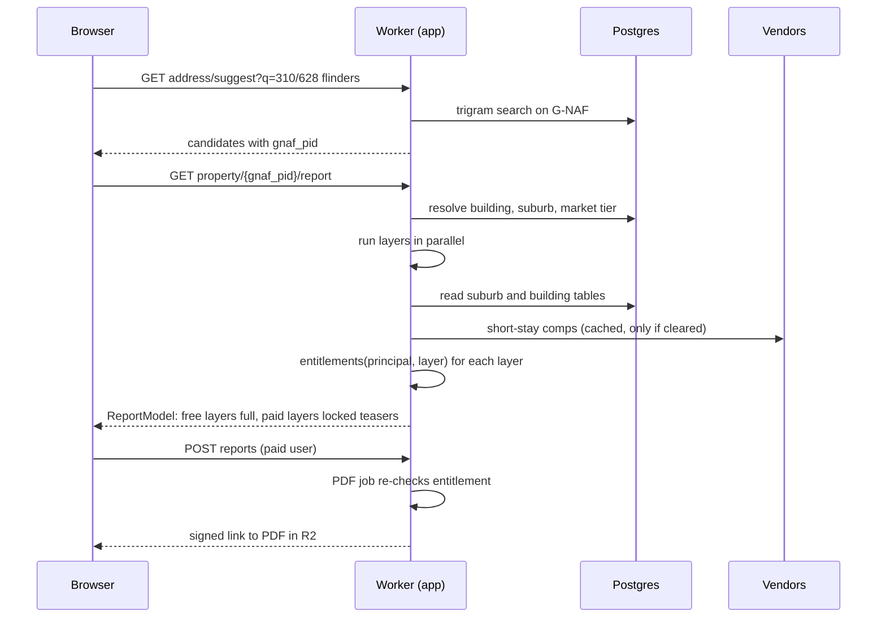

# VicProp: how the application is built (plain-language overview)

Written for Azwaan, to read before anything is built. The rules that bind builders are in `ARCHITECTURE-SPINE.md` (AD-1 to AD-10). This file explains them. `[ASSUMPTION]` means I chose it and you should confirm or change it.

## 1. The short version

Someone types an address. The app finds that address in the national address file (G-NAF), works out which building and suburb it is in, then asks about 15 small programs (**layers**) to each answer one question: rent, price history, short-stay, supply, planning and so on. Free layers come back in full. Paid layers come back as a one-line teaser, and the screen shows a blurred placeholder. Pay, and the same address returns everything, and you can download the A4 PDF.

Two separate halves:

- **Build half (offline):** scripts fetch public data, clean it, check it, and load it into the database. This is what you and I have been doing in `scripts/`.
- **Serve half (online):** a web app reads that database and answers lookups. It never touches the raw files.

## 2. The layers (what each report section is)

| Layer | Answers | Main sources | Free or paid `[ASSUMPTION]` |
| --- | --- | --- | --- |
| L01 Property | What is this property? | G-NAF, Vicmap | Free |
| L02 Rent | What does it rent for? | DFFH (VIC) and state rent files | Free |
| L03 Price | What is it worth in this suburb? | Valuer-General medians | Free |
| L04 Drivers | What makes it worth more or less? | Our price-driver model | Paid |
| L05 Return | What would the return be? | Calculator on L02 and L03 | Free (user-set inputs) |
| L06 Short-stay | Could it work as an Airbnb, who operates here? | Short-stay comps vendor, CRM building register | Paid |
| L07 History | How have prices moved? | Valuer-General series | Free |
| L08 Supply | What new apartments are coming? | City of Melbourne monitor, permits, ABS approvals | Paid |
| L09 Suburb compare | How does the suburb compare nearby? | Census, SEIFA, price and rent series | Free |
| L10 Screener | Where else could you invest? | Same series, all suburbs | Paid |
| L11 Building | What do we know about the building? | G-NAF units, City of Melbourne, comps vendor, recorded findings | Paid (unit count is free) |
| L12 Planning and rules | What does planning say, what are the short-stay rules? | Vicmap planning, state rules | Free |
| L13 Questions | What should you ask next? | Generated from gaps | Free |
| L14 Sources | Where did this come from? | Source registry | Free |
| L15 Conditions rating | How favourable are suburb conditions? | Census markers | Paid, VIC units only |
| L16 Transport | How close is transit? | GTFS | Free |

Each layer follows one contract (AD-1): same envelope, same evidence chips, same way of saying "unknown". That is what lets one paywall, one PDF and one web page work across all of them.

## 3. How one lookup works

Three things this is designed around: a failed vendor only blanks its own layer (AD-9), locked layers send no real numbers (AD-3), and the same ReportModel feeds web and PDF (AD-2).

## 4. Where data lives

| Store | What is in it | Why there |
| --- | --- | --- |
| **Neon Postgres** (with PostGIS and trigram search) | Addresses, buildings, suburbs; price and rent series; ratings; planning and supply facts; short-stay register; users, plans, reports; vendor cache; source registry | One database for everything queryable. The CRM already uses Neon, so the same driver and habits. |
| **Cloudflare R2** (file storage) | Raw downloaded files (reproducibility), generated PDFs (private, signed links) | Cheap bulk files; PDFs should not sit in the database. |
| **Your machine `data/raw/`** | Working copy of downloads (gitignored, about 1.9 GB) | Pipelines run here first; mirrored to R2 `[ASSUMPTION]`. |
| **City Retreats CRM database** (separate) | Properties and bookings | Stays separate. A nightly read-only job copies the building register into VicProp. |

Table groups in Postgres:

| Prefix | Content | Written by |
| --- | --- | --- |
| `ref_` | `ref_address`, `ref_building`, `ref_suburb` | pipelines |
| `series_` | suburb prices and rents by period, one row per (suburb, dwelling, period, dataset version) | pipelines |
| `derived_` | conditions rating, growth, units-per-building range | pipelines |
| `fact_` | short-stay register, supply projects, planning snapshots, recorded building findings | pipelines (findings: app) |
| `src_` | source registry (licence, rights status), dataset versions, current pointer | pipelines |
| `market_validation` | which state and dwelling type passed the backtest | validate step |
| `app_` | users, orgs, subscriptions, reports, lookup log | app |
| `vendor_cache` | outside API responses, with an expiry of 30 days at most | adapters |

**Size.** G-NAF is the big one. Load Victoria first and measure before loading other states `[ASSUMPTION]`.

## 5. How data gets in (build half)

| Step | What happens | Today's scripts |
| --- | --- | --- |
| Ingest | Download or call a source, save the raw file to R2, parse it | 14, 17, 24, 25, 33, 34, 35, 01, 02 |
| Derive | Compute rating, growth, units per building | 25, 33, 32, 36 |
| Validate | Row-count and range checks; backtests decide `market_validation` | 31, 36 |
| Publish | Write a dataset version, then flip the current pointer in one transaction | new |

Refresh cadence: quarterly for Valuer-General and rent files, annual for Census, monthly for approvals, monthly G-NAF `[ASSUMPTION]`. A report shows each figure's date, so a stale source is visible, not hidden.

## 6. APIs we build

All under `/api/v1`, JSON, same service code behind the web pages and any later public API.

| Endpoint | Purpose | Who |
| --- | --- | --- |
| `GET /address/suggest?q=` | Address autocomplete from G-NAF | anyone |
| `GET /address/{gnaf_pid}` | Resolved address: building, suburb, match type (unit / building only), market tier | anyone |
| `GET /property/{gnaf_pid}/report?view=investor` | The full `ReportModel`; paid layers locked unless entitled | anyone; entitlement per layer |
| `GET /property/{gnaf_pid}/layers/{layer_id}` | One layer, for lazy loading | same |
| `GET /building/{building_id}` | Building page: unit range, register, findings | free part; paid part locked |
| `POST /building/{building_id}/findings` | Record a finding from "questions to ask" | signed in |
| `GET /suburb/{sal_code}` | Suburb profile; rating only if validated, else market profile | anyone |
| `GET /screener?state=&dwelling=&sort=` | Suburb ranking | paid |
| `POST /reports` / `GET /reports/{id}` | Request a PDF (async), poll, get a signed link | paid |
| `GET /coverage` | Which states and layers are live, with validation status | anyone |
| `POST /billing/checkout`, `POST /webhooks/stripe` | Start payment, receive plan changes | signed in / Stripe |
| `GET /admin/sources`, `POST /admin/layers/{id}/enable` | Rights status, dataset age, turn a layer on only if all its sources are cleared | you only |

The build half has **no HTTP API**. It is commands: `npm run pipeline:<name>`.

## 7. APIs and sources we use

| External | Used for | When called | Rights today | Notes |
| --- | --- | --- | --- | --- |
| G-NAF (Geoscape, data.gov.au) | Address spine, building and unit counts | Batch, monthly | CC BY 4.0 plus no mailing-list compilation; full licence text unread | Ask Geoscape for a written OK |
| Vicmap WFS (`opendata.maps.vic.gov.au`) | Planning zones and overlays, building footprints | Live per address, cached | Open data | Same endpoint as `scripts/lib.mjs` |
| ABS Data API (`data.api.abs.gov.au`) | Census, SEIFA, population, approvals | Batch | CC BY | Needs `ABS,<flow>,<version>` form |
| Valuer-General / DataVic (VIC) | House and unit medians | Batch, quarterly | CC BY 4.0 | You download by hand: the site blocks scripts |
| DFFH rent files (VIC) | Suburb rents | Batch, quarterly | CC BY 4.0 | |
| QLD RTA, SA, NSW bonds, TAS bonds | Rents by state | Batch | CC BY; NSW live page silent | Not used for a rating (not validated) |
| City of Melbourne open data | Building age and size, dwellings, development monitor, permits | Batch | CC BY | Central Melbourne only |
| GTFS (VIC) | Transit | Batch | CC BY | |
| Short-stay comps vendor (AirDNA today) | Per-address income estimate, comps | Live per address, cached 30 days at most | **Resale rights unresolved: blocked until cleared** | Behind an adapter so AirROI or others can swap in |
| Microburbs API | Sale history, extra suburb fields | Per user, cached 30 days at most | **Pending written permission** | Off by default; never in shared tables or PDFs |
| realestate.com.au via RapidAPI | Benchmark only | None in product | **Blocked** | Do not ship |
| City Retreats CRM (Neon) | Building register: which operators, how many units | Nightly, read-only | Your own data | Aggregated only, no guest data `[ASSUMPTION]` |
| Stripe | Payments `[ASSUMPTION]` | Checkout, webhooks | Standard terms | GST handling to confirm |
| Cloudflare Browser Run | PDF from the print page | Per report | Standard | Billed per browser hour |

## 8. How free and paid works

- Four kinds of visitor: **anonymous** (limited lookups a day), **free account**, **paid** (individual or per report), **pro** (monthly seats, branded PDF, later an API key) `[ASSUMPTION]`.
- Prices come later. The system only needs to know a plan exists, which layers it opens, and its report allowance. Market evidence puts individuals at about $15 to $30 and professionals at about $99 to $500 a month, from the rating document.
- For a locked layer the server sends a headline sentence, never a figure. The blur on screen is drawn over made-up placeholder values. A user cannot reveal the real number by inspecting the page, because it was never sent.

## 9. What works in which state

| State | Report | Conditions rating | Why |
| --- | --- | --- | --- |
| VIC | Full | Units only | Only market with prices, rents and a passing backtest (74 to 80%) |
| SA | Address, building, planning, rents, SA house prices | No: descriptive profile | Backtest 36 to 58% |
| NSW, QLD, TAS | Address, building units, planning, rents | No: descriptive profile | Backtest at or below 50%, no price history |
| WA, ACT, NT | Address and building units, planning where licensed | No | No free prices or rents |

This table is generated from `market_validation` and `/coverage`, not typed by hand.

## 10. Suggested build order `[ASSUMPTION]`

1. **Foundation:** scaffold the app, Neon schema, source registry, dataset versioning, G-NAF Victoria loaded, address search.
2. **Free report (VIC):** layers L01, L02, L03, L07, L09, L12, L13, L14, L16. Web page and PDF from one ReportModel.
3. **Paywall:** entitlement seam, accounts, Stripe, locked teasers, PDF job.
4. **Paid VIC layers:** L11 building (units range, then register), L06 short-stay (once rights clear), L08 supply, L15 rating, L10 screener, L04 drivers.
5. **Prove it:** calibrate short-stay estimates against City Retreats bookings; show to 8 to 10 buyer's agents and operators; price from what they say.
6. **Other states:** descriptive profile and building layers first; rating only after a state backtest passes.

## 11. Things only you can settle

1. Written permission from the short-stay data vendor (AirDNA or another) to show and aggregate estimates in a paid product. Without it L06 cannot ship.
2. Written OK from Geoscape for G-NAF in a commercial product.
3. Whether Microburbs is wanted at all. The design works without it.
4. Login method and plan prices (deferred, not blocking steps 1 and 2).
5. Whether the building register may use CRM data beyond aggregate counts.
6. Delete the empty old folders in `data/raw` (`abs`, `dffh`, `vgv`, `gtfs`, `growth`, `com`, `macro`, `gnaf`, `infra projects`, `nsw/lodgements`, `sa/median`, `sa/rent`).
